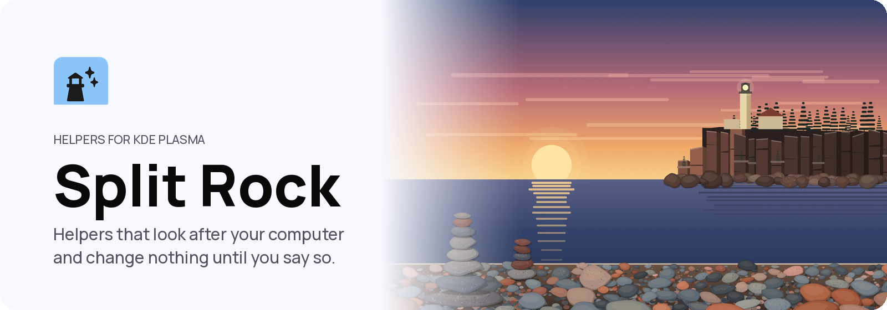

<p align="center">
  <picture>
    <source media="(prefers-color-scheme: dark)" srcset="assets/readme/banner-dark.png">
    
  </picture>
</p>

<p align="center">
  
  
  
  
</p>

<p align="center">
  <a href="#install">Install</a> · <a href="#controls">Controls</a> · <a href="docs/README.md">Docs</a> · <a href="#used-in-shuffle">Used in Shuffle</a>
</p>

<p align="center">
Helpers that look after a KDE Plasma computer, built for people leaving decades of Windows. Each Helper does one job, in plain words, and changes nothing until you tap its button. Core watches the computer quietly in the background and points you to the Helper that fits when something needs a look.
</p>


https://github.com/user-attachments/assets/b5c5d53a-4f06-4f06-9c3e-ebca5be75959


## What you get

<table>
<tr>
<td width="33%" valign="top"><b>Update</b><br>Lists every update before it starts, then runs it with a restore point first.</td>
<td width="33%" valign="top"><b>Free up space</b><br>Names everything it would remove before it removes any of it. Tidy up Downloads moves old downloads to the Trash.</td>
<td width="33%" valign="top"><b>Install or remove an app</b><br>Finds the app for what you need, or removes the one you name. Your apps lists what you added, biggest first.</td>
</tr>
<tr>
<td width="33%" valign="top"><b>Health check</b><br>Looks the computer over and says what is fine and what needs a look.</td>
<td width="33%" valign="top"><b>What changed</b><br>The last two weeks, with a way to undo a change or go back to before. Restore points and community apps have Helpers too.</td>
<td width="33%" valign="top"><b>Core</b><br>A background program with no window. It notices when space runs low, updates have waited too long, a problem turns up, a Windows program lands in Downloads or a new device is plugged in, and says so without nagging.</td>
</tr>
</table>

Each Helper opens in a window of its own, and the window closes with it.
Before it changes anything, it writes what it is about to change in your
notebook, an ordinary folder of notes, with how to undo it. How Core decides
when to speak is in [docs/CORE.md](docs/CORE.md).

<details>
<summary>What it never does</summary>

- Show you a terminal.
- Change anything without asking first.
- Hold your password. Anything that needs one uses the system's own prompt.
- Ask for money or card details.

</details>

## Controls

| Task | Touch | Keyboard |
| --- | --- | --- |
| Open a Helper | Tap it in Search | None yet |
| Act on a Helper | Tap its button | None yet |
| Undo a past change | Tap Undo beside a change on What changed | None yet |
| Scroll | Drag the Helper | None yet |
| Close | Tap Close or Not now, or close the window | The window's own |

Every input, with what you see happen, is in [docs/INPUT.md](docs/INPUT.md).

## Install

These steps are for Arch Linux or CachyOS with KDE Plasma. The Helpers look
after an Arch-based system: updates and apps go through pacman and Flatpak,
and restore points through snapper where the disk supports them. Split Rock is
built on your computer from this page's code, so you type a few commands into
**Konsole**, Plasma's terminal. Open it from the application launcher.

### 1. What you need

Bring the computer up to date. If you just did this for another part of the
suite, skip it:

```bash
sudo pacman -Syu
```

Restart the computer only if that update installed a new `kwin`,
`plasma-workspace` or kernel (`linux`, or `linux-cachyos` on CachyOS): Split Rock is built against what is
installed, so that has to be what is running.

Then install what the build needs. Type your password when asked, and answer
`Y`:

```bash
sudo pacman -S --needed base-devel git cmake ninja python dbus bubblewrap noto-fonts qt6-base qt6-declarative llama-cpp
```

`llama-cpp` is the engine that runs Ask's model on this computer. Without it,
Ask can download the model but still can't answer.

If pacman says a package **is up to date -- skipping**, or **there is nothing
to do**, that is normal: it is already installed.

### 2. Download

This puts the code in a folder called `split-rock` in your home folder. Use
`git`, not GitHub's Download ZIP: the installer's checks read the download's
history.

```bash
cd ~
git clone https://github.com/carlsonjm/split-rock.git
cd split-rock
```

### 3. Install

```bash
./install.sh
```

The installer checks the code, builds it and runs every test. Then it asks for your password in Konsole (nothing shows as you
type) to install the Helpers, Core, the guide and the tour for every account
on the computer. It ends with **Split Rock installed**.

### 4. Finish

Sign out and back in. Core, the part that watches the computer, starts by
itself from then on, with no window.

### 5. Check it worked

Open a Helper by its name. With [Tettegouche](https://github.com/carlsonjm/tettegouche)
installed, press `Meta` and type **Health check**. Without it, run this once
in Konsole:

```bash
split-rock --card health
```

Health check opens in a window of its own, looks the computer over and says
what is fine and what needs a look. It changes nothing. The other Helpers'
names are `update`, `space`, `install`, `uninstall`, `apps`, `changes`,
`restore` and `community`.

### Ask, on this computer

Ask answers questions about the computer in plain words, from Search's **Ask**
tab where Tettegouche is installed. It runs a language model on this computer,
so nothing you ask leaves it. The model is not part of the download above. The
first time you use Ask it offers to fetch it: **Qwen3 4B**, an open model under
the Apache 2.0 licence, one file of about 2.5 GB. Tap **Download** and it comes
once, is checked against its known fingerprint, and is kept in
`~/.local/share/split-rock/models`. A download that stops carries on where it
left off. Until it is there, Ask still points you to the Helper that fits.

### 6. Update

To get a newer Split Rock:

```bash
cd ~/split-rock
git pull
./install.sh
```

It removes what the earlier install placed first, and replaces Core if it is
running. A Helper's window already open keeps the old program until it closes.

### 7. Uninstall

```bash
cd ~/split-rock
./uninstall.sh
```

It asks for your password and ends with **Split Rock removed**. Your notebook,
Documents › Notebook, where each Helper wrote what it changed, stays. To
delete the download too, run `rm -rf ~/split-rock` after uninstalling.
Ask's model stays too; to free its 2.5 GB, run
`rm -rf ~/.local/share/split-rock/models`.

<details>
<summary>With Shuffle</summary>

Split Rock works on any KDE Plasma desktop. Its Helpers open from Core's
notices, and from Search where Tettegouche is installed, as it is in Shuffle.

</details>

## For developers

<details>
<summary>Working on Split Rock</summary>

Read [AGENTS.md](AGENTS.md) before working in this repository. The documentation
index is [docs/README.md](docs/README.md). Run `./verify.sh` before proposing a
change: it checks the public text and the guide, builds Split Rock and runs
every test.

`./run.sh space` builds Split Rock and opens Free up space from this checkout;
any other Helper's name works the same way: `update`, `tidy`, `install`,
`apps`, `health`, `changes`, `restore` or `community`.

</details>

## Used in Shuffle

Shuffle, a touch-first desktop built on KDE Plasma, uses Split Rock for its
Helpers. The other open-source projects it uses are
[Kadunce](https://github.com/carlsonjm/kadunce),
[Tettegouche](https://github.com/carlsonjm/tettegouche),
[Temperance](https://github.com/carlsonjm/temperance),
[Gooseberry](https://github.com/carlsonjm/gooseberry) and
[Shuffle Keyboard](https://github.com/carlsonjm/shuffle-keyboard). Shuffle's own
site is [shuffleplasma.com](https://shuffleplasma.com).

## License

Split Rock is licensed under GPL-2.0-or-later. See [LICENSE](LICENSE).

The project names and marks are not covered by that licence. See
[TRADEMARKS.md](TRADEMARKS.md).

<p align="center"><picture><source media="(prefers-color-scheme: dark)" srcset="assets/readme/good-input-white.png"></picture></p>
